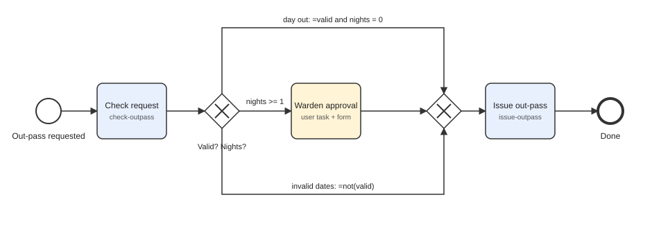

# Hostel Out-Pass Workflow — Camunda 8 SaaS + Spring Boot

Automates the SRM hostel out-pass request. The business logic runs in a Spring Boot app on your laptop; the process runs on a Camunda 8 SaaS cluster. The app only makes **outbound** calls, so no port forwarding is needed.



## Process rules
1. `POST /outpass` with `studentName, regNo, hostelBlock, outDate, returnDate, parentPhone, purpose`.
2. **Check request** (`check-outpass`) computes `nights`, sets `valid = false` if the return date is before the out date.
3. Gateway: invalid → reject; `nights = 0` → auto-approve; `nights >= 1` → **Warden approval** user task (form: `approved`, `wardenRemarks`).
4. **Issue out-pass** (`issue-outpass`) creates `OP-<regNo>-<outDate>` for approved requests and logs "SMS to parent".
5. Ends with `passStatus = ISSUED` or `REJECTED`.

## Project structure
```
outpass-workflow/
├─ pom.xml
├─ test-requests.sh                      3 curl test cases
├─ docs/                                 variables note, diagram, screenshots
└─ src/main/
   ├─ java/edu/srmist/outpass/
   │  ├─ OutpassWorkflowApplication.java  @SpringBootApplication + @Deployment
   │  ├─ api/OutpassController.java       POST /outpass
   │  ├─ api/OutpassRequest.java          request body
   │  └─ worker/OutpassWorkers.java       check-outpass, issue-outpass
   └─ resources/
      ├─ application.yaml                 SaaS credentials (via env vars)
      └─ bpmn/hostel-outpass.bpmn, warden-approval.form
```

## Values that must match (model ↔ code)
| In the model | Value | In the code |
|---|---|---|
| Process ID | `hostel-outpass` | `bpmnProcessId("hostel-outpass")` |
| Task type | `check-outpass` | `@JobWorker(type = "check-outpass")` |
| Task type | `issue-outpass` | `@JobWorker(type = "issue-outpass")` |
| Form ID | `warden-approval-form` | form file in `@Deployment` |
| Form keys | `approved`, `wardenRemarks` | `@Variable` names in `issueOutpass` |

## Setup
**1. Camunda Console** (console.camunda.io): Clusters → Create new cluster (`outpass-demo`, nearest region, **8.8**) → wait for *Healthy* → **API** tab → Create new client (`outpass-app`, tick Zeebe / Orchestration Cluster scope) → copy **Client ID, Client Secret, Cluster ID, Region** (Spring Boot tab).

**2. Web Modeler:** New project → Upload files → `hostel-outpass.bpmn` and `warden-approval.form` from `src/main/resources/bpmn/`. Confirm Process ID `hostel-outpass` and the two task types. (No need to click Deploy; the app deploys on start.)

**3. Credentials** — pick one:
- Environment variables (Windows PowerShell):
  ```powershell
  $env:CAMUNDA_CLIENT_ID="..."; $env:CAMUNDA_CLIENT_SECRET="..."
  $env:CAMUNDA_CLUSTER_ID="..."; $env:CAMUNDA_CLUSTER_REGION="bru-2"
  ```
  (Linux/macOS: `export CAMUNDA_CLIENT_ID=...` etc.)
- Or copy `application-local.yaml.example` → `application-local.yaml`, fill it in, and run with `-Dspring-boot.run.profiles=local`. This file is git-ignored.

**4. Run** (JDK 17+, Maven 3.9+):
```bash
mvn spring-boot:run
```
Look for the deployment of `hostel-outpass` and the workers opening in the log.

## Test (3 cases)
Run `./test-requests.sh` (Git Bash/macOS/Linux) or use Postman: `POST http://localhost:8080/outpass`, Body → raw → JSON.

| Case | Dates | Expected |
|---|---|---|
| Auto-approved | out `2026-10-20`, return `2026-10-20` | Completes immediately, `passStatus=ISSUED` |
| Warden approval | out `2026-10-20`, return `2026-10-22` | Token waits at *Warden approval* in Operate. In **Tasklist**: open task → Assign to me → tick Approve, add remarks → Complete → `ISSUED` |
| Rejected | out `2026-10-22`, return `2026-10-20` | Takes the invalid path, `passStatus=REJECTED` |

Then take the screenshots listed in `docs/screenshots/README.md`.

## Push to GitHub
```bash
cd outpass-workflow
git init
git add .
git commit -m "Hostel out-pass workflow: Camunda 8 + Spring Boot"
git branch -M main
git remote add origin https://github.com/<your-username>/outpass-workflow.git
git push -u origin main
```
Create the empty repo on github.com first (no README/.gitignore). Check `git status` shows no real secrets before pushing.

## Bonus (2 marks): escalate after 24 h
In Web Modeler, select *Warden approval* → attach a **Timer boundary event** (non-interrupting or interrupting) with duration `PT24H` → connect it to a new user task **Chief Warden approval** (same form `warden-approval-form`) → connect that task to the merge gateway. Export, replace `hostel-outpass.bpmn`, restart the app. For a quick demo use `PT1M`.

## Troubleshooting
| Symptom | Fix |
|---|---|
| 401 Unauthorized at start-up | Wrong client ID/secret, or client lacks the Zeebe / Orchestration Cluster scope. Recreate the client. |
| UNAVAILABLE / cannot connect | Wrong cluster ID or region. Don't set grpc/rest addresses by hand in SaaS mode. |
| Instance stuck at a service task | Worker `type` doesn't match the task type in the model. |
| Incident "Text cannot be parsed" | Date not in `yyyy-MM-dd`. Fix the variable in Operate and Retry. |
| User task has no form | Form ID not linked, or `.form` missing from `@Deployment`. |
| Old code doesn't compile | Use `CamundaClient` and `io.camunda.client.annotation.*`, not `ZeebeClient`. |
